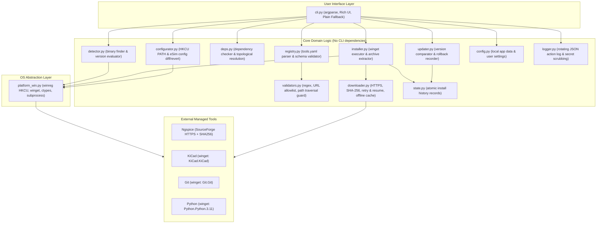

# eSim Automated Tool Manager (`esim-tool-manager`)

[](https://microsoft.com)
[](https://python.org)
[](https://esim.fossee.in)
[](LICENSE)
[](https://github.com/astral-sh/ruff)
[](https://pytest.org)

> **FOSSEE eSim Semester Long Internship (Autumn 2026) — Screening Task 5**  
> A resilient, secure, and production-ready CLI application that automates the installation, verification, dependency checking, update management, and user-level configuration of external tools required by the **eSim** open-source EDA suite on Windows.

---

## ⚡ Overview

[eSim](https://esim.fossee.in/) is an open-source EDA tool developed by FOSSEE at IIT Bombay for schematic design, circuit simulation, and PCB design. It depends on several external engines and suites—notably **Ngspice** (circuit simulation) and **KiCad** (schematic capture and PCB layout), in conjunction with **Python** and **Git**.

Configuring and maintaining these heterogeneous external tools on student and developer Windows machines is frequently prone to path conflicts, missing runtime binaries, outdated versions, broken dependencies, and unstable internet downloads.

`esim-tool-manager` solves this by delivering an automated, offline-capable, and secure tool manager built specifically for Windows 10/11. It implements all 5 core requirements:
1. **Tool Installation Management (R1)**: Automated installation of pinned versions via verified Windows Package Manager (`winget`) and direct HTTPS downloads with SHA-256 verification and atomic extraction.
2. **Update and Upgrade System (R2)**: Detection of upstream updates, safe rollback records, and version compliance enforcement.
3. **Configuration Handling (R3)**: Registry-based user-level `PATH` manipulation (`HKCU\Environment`), environment broadcast (`WM_SETTINGCHANGE`), eSim path linking, visual diff previews, and exact `--revert` undo.
4. **Dependency Checker (R4)**: Topological dependency validation, semantic version compliance (`packaging.version`), executable path lookup, and concrete remediation advice.
5. **User Interface and Action Log (R5)**: High-fidelity terminal UI via `rich` with ASCII fallback, rotating structured action logs (`RotatingFileHandler`), and complete secrets redaction.

---

## 🏛️ Architecture

`esim-tool-manager` is structured with clean separation of concerns. Every platform-specific Windows call is strictly isolated in `platform_win.py` so Linux (`apt`) and macOS (`homebrew`) backends can be plugged in without touching core domain logic.



---

## 🚀 Key Features

- **🛡️ Secure by Design**:
  - Validates all tool names against `^[a-z0-9-]+$`.
  - Rejects any file path containing relative directory traversal (`..`).
  - Restricts downloads strictly to `https://` with a rigid domain allowlist (`sourceforge.net`, `github.com`, `kicad.org`, `python.org`).
  - Always verifies 64-character SHA-256 checksums before unpacking or running installers.
  - Subprocess calls use argument lists exclusively; **zero** usage of `shell=True`.
- **📶 Offline-Resilient Downloads**:
  - Exponential backoff retry mechanism with configurable maximum attempts.
  - Resumes interrupted downloads using HTTP `Range` headers.
  - Maintains a local installer cache in `%LOCALAPPDATA%\esim-tool-manager\cache\` to enable fully offline reinstalls.
- **⚙️ Non-Elevated by Default**:
  - Modifies `PATH` strictly in `HKEY_CURRENT_USER\Environment` without requiring Administrator privileges.
  - Automatically broadcasts `WM_SETTINGCHANGE` so newly launched shells and applications instantly recognize updated paths.
- **🔄 State Rollback & Diffs**:
  - Captures full pre-upgrade state metadata before upgrading any tool.
  - Unified `rollback <tool>` command restores previous binaries and configurations on failure.
  - Visual color diffs displayed before applying any system or eSim configuration changes.

---

## 📦 Windows Prerequisites

Before running the tool, ensure your Windows machine has:
1. **Windows 10 (version 1809+) or Windows 11**.
2. **Python 3.10+**: Verify with `python --version`.
3. **Git**: Verify with `git --version`.
4. **Windows Package Manager (`winget`)**: Bundled with modern Windows via "App Installer". Verify with `winget --version`.

---

## 🛠️ Quickstart

### 1. Clone the Repository
```powershell
git clone https://github.com/Eyantra698Sumanto/esim-tool-manager.git
cd esim-tool-manager
```

### 2. Install Python Dependencies
```powershell
python -m pip install -r requirements.txt
```

### 3. Initialize the Manager
```powershell
python -m esim_tool_manager init
```

### 4. Inspect Tool Status
```powershell
python -m esim_tool_manager list
```

### 5. Check System Compliance & Dependencies
```powershell
python -m esim_tool_manager check
```

---

## 📖 Command Reference

| Command | Description | Exit Codes |
|---|---|---|
| `init` | Create user data directories (`%LOCALAPPDATA%\esim-tool-manager`), write default configuration, and test winget/Git availability. | `0` (Success), `1` (Error) |
| `list` | Print a Rich table showing each tool's installed version, required minimum version, pinned version, binary location, and status. | `0` (Success), `1` (Error) |
| `check` | Run R4 compliance check: verify binaries exist, meet version thresholds, and declared dependencies are satisfied. | `0` (Compliant), `2` (Missing / Incompatible) |
| `install <tool> \| all` | Download, verify SHA-256, unpack/install, and verify tool functionality. Idempotent. | `0` (Success), `1` (Error), `3` (Cancelled) |
| `update check` | Query upstream winget or GitHub releases to identify available tool updates. | `0` (Success), `1` (Error) |
| `update <tool> \| all` | Upgrade a tool to the latest pinned version with automatic backup of previous state. | `0` (Success), `1` (Error), `3` (Cancelled) |
| `rollback <tool>` | Revert a tool to its previously recorded installation state. | `0` (Success), `1` (Error) |
| `configure` | Write HKCU `PATH` environment entries and generate `esim_config.ini` with diff confirmation. | `0` (Success), `1` (Error), `3` (Cancelled) |
| `configure --revert` | Completely undo all environment and configuration changes recorded by the tool. | `0` (Success), `1` (Error) |
| `doctor` | Run comprehensive diagnostics across permissions, network, registry, logs, and binaries. | `0` (Healthy), `1` (Issues found) |
| `cache list` | Display all cached installers and archive packages. | `0` (Success) |
| `cache clear` | Delete cached installer archives to free disk space. | `0` (Success) |
| `logs [--tail N]` | Display recent structured action log entries. | `0` (Success) |
| `report [-o path]` | Generate and export a complete Markdown audit report. | `0` (Success) |
| `config get <key>` | Read a user configuration parameter (e.g. `esim_path`). | `0` (Success) |
| `config set <k> <v>` | Update a user configuration parameter. | `0` (Success), `1` (Validation Error) |
| `version` | Display application version. | `0` (Success) |

### Global Flags
- `--dry-run`: Simulate operations without modifying the filesystem, registry, or executing external installers.
- `--verbose`, `-v`: Print detailed step-by-step diagnostic progress.
- `--debug`: Display full exception tracebacks in the terminal (also recorded in the action log).

---

## 💻 Sample Terminal Output

### `python -m esim_tool_manager list`
```
                           eSim Managed Tools Status                           
┌────────────┬──────────────────┬──────────────┬───────────────┬─────────────┬────────────────────────────────────────────────────────┐
│ Tool       │ Installed        │ Required     │ Pinned        │ Status      │ Binary Path                                            │
│            │ Version          │ (Min)        │ Version       │             │                                                        │
├────────────┼──────────────────┼──────────────┼───────────────┼─────────────┼────────────────────────────────────────────────────────┤
│ Git        │ 2.52.0           │ 2.30.0       │ 2.56.1        │ OUTDATED    │ C:\Program Files\Git\cmd\git.exe                       │
│ KiCad      │ Not installed    │ 7.0.0        │ 10.0.8        │ MISSING     │ Not found                                              │
│ Ngspice    │ Not installed    │ 34.0         │ 43.0          │ MISSING     │ Not found                                              │
│ Python     │ 3.14.2           │ 3.10.0       │ 3.11.9        │ OK          │ C:\Users\DELL\AppData\Local\Python\bin\python.exe       │
└────────────┴──────────────────┴──────────────┴───────────────┴─────────────┴────────────────────────────────────────────────────────┘
```

### `python -m esim_tool_manager check`
```
INFO: Running dependency and version compliance checks...
WARNING: Git: OUTDATED (version 2.52.0 meets minimum 2.30.0, recommended pinned is 2.56.1).
INFO:   Fix: Version 2.52.0 meets minimum (2.30.0), but recommended pinned version is 2.56.1. Run 'esim-tool-manager update git' to upgrade.
┌────────────────────────────── Action Required ──────────────────────────────┐
│ ERROR: KiCad: MISSING (Installed: None, Required: 7.0.0)                    │
│ Suggested Fix: Install KiCad using: esim-tool-manager install kicad         │
└─────────────────────────────────────────────────────────────────────────────┘
┌────────────────────────────── Action Required ──────────────────────────────┐
│ ERROR: Ngspice: MISSING (Installed: None, Required: 34.0)                   │
│ Suggested Fix: Install Ngspice using: esim-tool-manager install ngspice     │
└─────────────────────────────────────────────────────────────────────────────┘
SUCCESS: Python: OK (version 3.14.2 at C:\Users\DELL\AppData\Local\Python\bin\python.exe)
WARNING: 
One or more tools are missing, incompatible, or have unmet dependencies.
EXITCODE: 2
```

---

## 🧪 Testing & Verification

The test suite contains unit tests, integration tests with mocked subsystems, and dedicated abuse-case security tests:

```powershell
# Run the complete test suite with coverage
python -m pytest tests/unit -v --cov=esim_tool_manager

# Run linting and code formatting checks
python -m ruff check .
python -m black --check .

# Run static type checking
python -m mypy esim_tool_manager
```

---

## 🔒 Security Scope & Hardening

As an administrative and developer CLI utility running locally on Windows:
- **No Web Surface**: No open HTTP listener, session cookies, CSRF, passwords, or authentication endpoints exist.
- **Least Privilege**: Runs un-elevated by default. Registry operations target `HKCU` rather than machine-wide `HKLM`.
- **Integrity Enforcement**: Binary installers are verified against cryptographic SHA-256 hashes before unpacking. Corrupt or mismatched files are automatically quarantined and deleted.
- **Strict Allowlisting**: Network downloads accept only pre-approved HTTPS domains.
- **Defensive Subprocess Execution**: Arguments are passed strictly as lists; user strings never touch shell interpreters.

---

## ❓ Troubleshooting

| Issue | Cause | Solution |
|---|---|---|
| `winget is not recognized` | Windows App Installer missing or outdated | Install or update "App Installer" from the Microsoft Store, or get winget directly from [winget-cli releases](https://github.com/microsoft/winget-cli/releases). |
| `Checksum mismatch` | Interrupted download or mirrored file discrepancy | Run `esim-tool-manager cache clear` and re-run `install`. Ensure stable connection or VPN. |
| `Permission denied writing PATH` | Local corporate security policy restricting HKCU registry | Check user registry permissions on `HKCU\Environment`. Run PowerShell as user. |
| `KiCad not found after install` | System PATH not reloaded in current shell session | Close and re-open PowerShell, or run `esim-tool-manager configure` to sync user PATH. |

---

## 📄 License

This project is licensed under the **GNU General Public License v3.0 (GPLv3)**. See the [LICENSE](LICENSE) file for complete details.

Developed for the **FOSSEE eSim Semester Long Internship Screening Task 5**.
