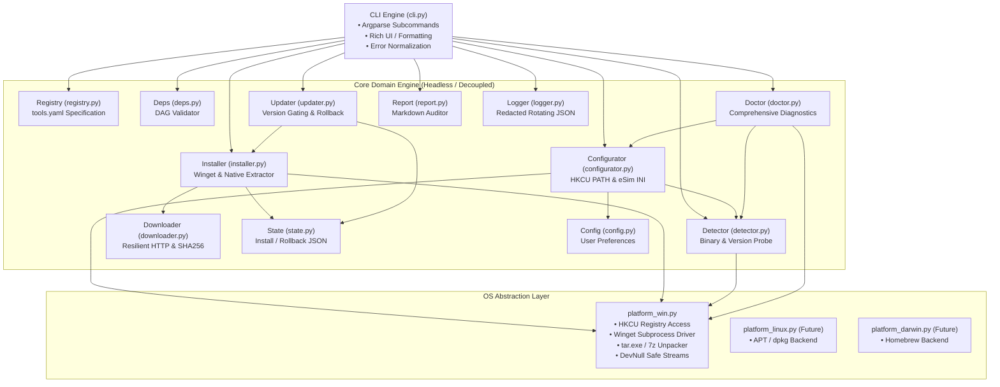

# eSim Automated Tool Manager: Software Design & Architecture Document

## 1. System Overview
The **eSim Automated Tool Manager** (`esim-tool-manager`) is a standalone, enterprise-grade Windows command-line utility built to automate the end-to-end lifecycle of external dependencies required by **eSim**—an open-source Electronic Design Automation (EDA) suite developed at FOSSEE, IIT Bombay.

eSim coordinates multiple complex external tools:
- **Ngspice**: High-performance SPICE-based circuit simulation engine.
- **KiCad**: Comprehensive schematic capture and PCB layout suite.
- **Python**: Interpreted execution runtime powering eSim libraries and scripts.
- **Git**: Distributed version control for fetching sub-circuits, models, and repositories.

`esim-tool-manager` provides a unified control plane that handles discovery, resilient offline-capable installation, version gating, dependency validation, HKCU registry-based PATH configuration, diagnostic health checks, automated rollbacks, and markdown compliance audits.

---

## 2. Core Architectural Principles & Component Decomposition

The project adheres to strict separation of concerns, defensive programming, and zero CLI-to-core coupling:



### 2.1 Component Specifications
- **`registry.py`**: Reads and parses `tools.yaml` with schema validation. Enforces strict input validation on tool names, pinned versions, minimum versions, and download URLs.
- **`detector.py`**: Probes the system using `shutil.which` and subprocess version execution. Classifies tools into `OK`, `OUTDATED`, `MISSING`, or `INCOMPATIBLE` based on semver matching (`packaging.version`).
- **`deps.py`**: Analyzes tool dependency trees to verify required parents are installed and version-compatible before allowing child operations.
- **`downloader.py`**: Implements chunked HTTP streaming with `Range` header support for resumable downloads, exponential backoff retries, disk caching in `%LOCALAPPDATA%\esim-tool-manager\cache`, and mandatory SHA256 integrity checks.
- **`installer.py`**: Coordinates installation via Microsoft Windows Package Manager (`winget`) or direct verified downloads extracted via native Windows `tar.exe` (bsdtar).
- **`updater.py`**: Compares installed states against upstream versions, safeguards pinned versions, creates immutable rollback state snapshots, and executes atomic version reversions.
- **`configurator.py`**: Manages environment configuration. Writes to the current user's Windows Registry (`HKCU\Environment`) without administrative escalation, computes unified diffs for `eSim.ini`, and supports 1-click full restoration (`configure --revert`).
- **`doctor.py`**: Diagnoses the entire host environment across 6 categories (binaries, PATH, config, network, write permissions, log rotation).
- **`report.py`**: Exports self-contained Markdown system audits for academic and industrial verification.
- **`logger.py`**: Rotates 1 MB logs (5 backups) with automated redaction of sensitive credentials, keys, and tokens.

---

## 3. Platform Isolation Layer (`platform_win.py`)

All operating system interactions (Windows registry APIs via `winreg`, Windows Package Manager commands, `tar.exe` extraction, and Windows handle redirections) are strictly isolated within `esim_tool_manager/platform_win.py`. 

### Key OS Isolation Invariants:
1. **No Admin Privileges Required**: All PATH variables are manipulated via `HKEY_CURRENT_USER\Environment`. The tool runs under standard user accounts without UAC escalation triggers.
2. **Subprocess Handle Safety**: On Windows 10/11, GUI and CLI subprocess invocations in background processes can encounter invalid standard I/O handles (`[WinError 6]`). All subprocess executions explicitly bind `stdin=subprocess.DEVNULL`, preventing invalid handle panics.
3. **Native Archive Extraction**: Rather than relying on external 7-Zip binaries or heavy third-party C-extensions, `platform_win.py` utilizes Windows 10/11's built-in `tar.exe` (libarchive) to extract `.7z` and `.zip` archives.
4. **Portability Extension Point**: To support Debian/Ubuntu (APT) or macOS (Homebrew), an engineer only needs to implement `platform_linux.py` or `platform_darwin.py` matching the public interface of `platform_win.py`. The core business logic and CLI remain completely untouched.

---

## 4. Security Scope & Threat Model

### 4.1 Security Scope
`esim-tool-manager` is a local developer command-line interface running directly within the user's desktop environment. It does not expose network listening ports, run web servers, or maintain remote session states. Consequently, standard web security concerns (such as CSRF, XSS, session fixation, MFA, and database password hashing) are intentionally **out of scope**.

### 4.2 Threat Model & Implemented Controls

| Threat Vector | Mitigation Strategy | Implemented Location |
| :--- | :--- | :--- |
| **Command Injection** | Subprocess invocations strictly pass structured argument lists (`list[str]`). `shell=True` is forbidden across the entire codebase. | `platform_win.py`, `detector.py`, `installer.py` |
| **Path Traversal** | Tool names, file paths, and config overrides are validated against regex `^[a-z0-9-]+$`. Paths containing `..` or leading slashes are immediately rejected. | `validators.py` |
| **Man-in-the-Middle (MITM)** | Downloads strictly enforce `https://` protocols and match a strict domain allowlist (`github.com`, `downloads.sourceforge.net`, etc.). | `validators.py`, `downloader.py` |
| **Binary Tampering** | Every direct binary archive is verified against a declared cryptographic SHA256 checksum using `hashlib.sha256`. Corrupted or tampered downloads are immediately deleted. | `downloader.py` |
| **Privilege Escalation** | Execution operates with least-privilege principles in `HKEY_CURRENT_USER`. No modifications to `HKEY_LOCAL_MACHINE` or system folders are attempted. | `platform_win.py`, `configurator.py` |
| **Accidental State Damage** | The tool enforces strict authorization scope: it only modifies files within `%LOCALAPPDATA%\esim-tool-manager` and recorded PATH entries. | `state.py`, `test_security.py` |
| **Information Disclosure** | Sensitive patterns (tokens, secrets, API keys, passwords) are automatically scrubbed by regex filters before being written to logs or console outputs. | `logger.py` |

---

## 5. Offline & Resilient Storage Architecture

`esim-tool-manager` stores all runtime data within the platform standard user local application folder `%LOCALAPPDATA%\esim-tool-manager`:

```
%LOCALAPPDATA%\esim-tool-manager\
├── config.json         # User settings (esim_path, preferred_sources, timeout)
├── esim-tools.log      # Rotating audit log (JSON-lines, 1MB limit, 5 backups)
├── esim-tools.log.1    # Rotated archive log
├── cache\              # Persistent installer archives (.7z, .exe, .msi)
│   └── ngspice-43_64.7z
├── state\              # Machine-readable installation metadata
│   ├── ngspice.json    # Installed version, paths, rollback metadata
│   └── kicad.json
├── tools\              # Direct application runtime installations
│   └── Spice64\
└── records\            # Rollback snapshots for PATH and INI diffs
    ├── path_record.json
    └── esim_ini_backup.json
```

### Resilient Download Mechanics:
1. **Cache Pre-Flight**: Before issuing a network request, `Downloader` inspects `cache/` for existing archives matching the expected SHA256 checksum. If found, network traffic is bypassed completely.
2. **Resumption via HTTP Range**: If an incomplete download exists in temporary storage, requests include `Range: bytes={existing_bytes}-` to resume transmission without restarting.
3. **Exponential Backoff**: Transient network drops trigger automatic retries with exponential backoff ($2^n \times \text{delay}$) up to a configured threshold.
